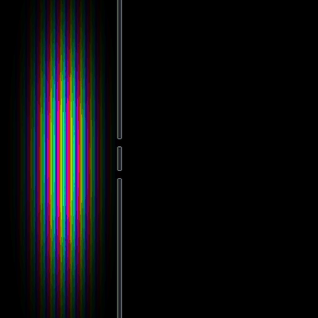
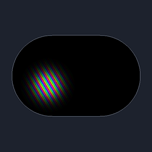
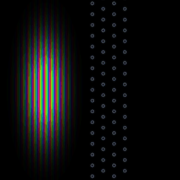
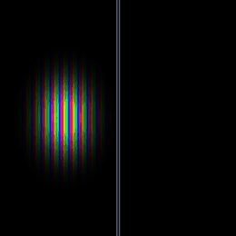
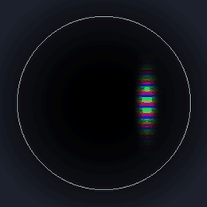
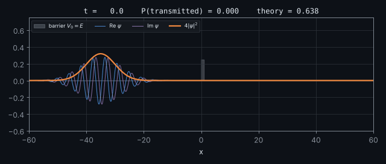
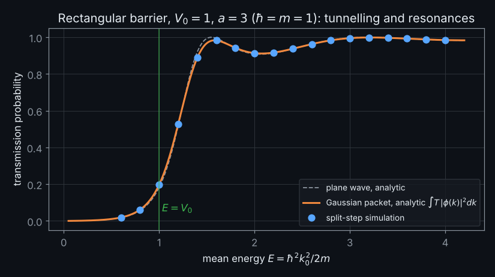
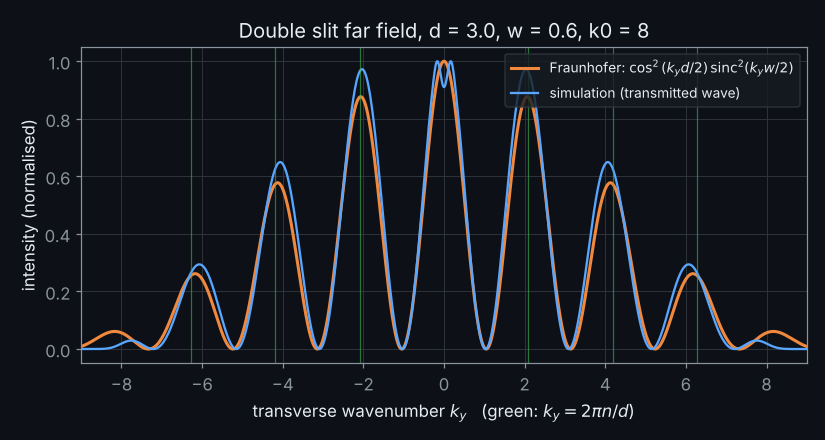
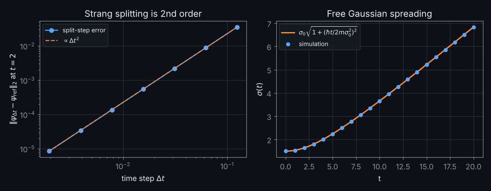

<div align="center">

# wavepacket

**The time-dependent Schrödinger equation in 1D and 2D, solved with the split-step Fourier method.**
Double slits, tunnelling, crystal diffraction and chaotic quantum billiards, all checked against analytic results.

[](https://github.com/aadijewargi/wavepacket/actions/workflows/ci.yml)
[](https://aadijewargi.github.io/wavepacket/)
[](pyproject.toml)
[](LICENSE)



*A single electron-like wavepacket goes through both slits at once. Hue is the phase of ψ and brightness is |ψ|.*

### [▶ Try it in your browser](https://aadijewargi.github.io/wavepacket/): drag to launch packets, paint your own walls

</div>

---

## Gallery

| Quantum stadium billiard | Crystal (Bragg) diffraction | Tunnelling at $E = V_0$ | Squeezed state in a trap |
|:---:|:---:|:---:|:---:|
|  |  |  |  |
| Classically chaotic, so the wave scrambles into speckle | A lattice of atoms works as a diffraction grating | Half of the packet reflects and half gets through | Orbits classically while its width breathes |

<p align="center"></p>

## The physics

A non-relativistic particle of mass $m$ in a potential $V(\mathbf r)$ obeys

$$
i\hbar\,\frac{\partial \psi}{\partial t} = \hat H\psi = \Big[\underbrace{-\frac{\hbar^2}{2m}\nabla^2}_{\hat T} + \underbrace{V(\mathbf r)}_{\hat V}\Big]\psi .
$$

The formal solution is $\psi(t+\Delta t) = e^{-i\hat H\Delta t/\hbar}\psi(t)$. The trouble is that $\hat T$ is diagonal in **momentum** space and $\hat V$ is diagonal in **position** space, and the two operators do not commute. Strang splitting handles this by applying them one at a time:

$$
e^{-i(\hat T+\hat V)\Delta t/\hbar} = e^{-i\hat V\Delta t/2\hbar}\; e^{-i\hat T\Delta t/\hbar}\; e^{-i\hat V\Delta t/2\hbar} + \mathcal O\big(\Delta t^3\,[\hat T,[\hat T,\hat V]],\ \Delta t^3\,[\hat V,[\hat V,\hat T]]\big).
$$

One time step therefore costs:

1. multiply by $e^{-iV(\mathbf r)\Delta t/2\hbar}$ on the grid;
2. FFT to momentum space and multiply by $e^{-i\hbar |\mathbf k|^2\Delta t/2m}$;
3. inverse FFT, then apply the second potential half-step. Consecutive half-steps are fused, so $n$ steps take $n$ FFT pairs.

This scheme has several useful properties:

* **Unitary.** Each factor has modulus 1, so $\int|\psi|^2$ is conserved to machine precision for any $\Delta t$. The scheme is unconditionally stable.
* **Second order.** The symmetric splitting cancels the $\mathcal O(\Delta t^2)$ local error, so the global error is $\mathcal O(\Delta t^2)$ (measured slope: 2.00).
* **Spectral in space.** Derivatives are exact for every Fourier mode the grid can represent. The only spatial requirement is that the packet's wavenumbers stay below the Nyquist limit, $|k| < \pi/\Delta x$.
* **Exact for free particles.** With $V=0$ the kinetic step is the exact propagator. The test suite reproduces the analytic spreading Gaussian to $10^{-14}$.

**Open boundaries.** FFTs make the box periodic. To stop outgoing waves from wrapping around, a *complex absorbing potential* $V \to V - iW(\mathbf r)$ is added, with $W = W_0 s^2$ rising quadratically over a layer at the edges. The factor $e^{-W\Delta t/2\hbar}$ then damps the wave smoothly, without the reflection a hard cutoff would cause.

**Walls.** Hard walls are tall finite barriers ($V_0 \gg E$). A perfectly sharp wall scatters a small amount of amplitude to the grid's Nyquist wavenumbers, where the kinetic energy can exceed the wall height and leak through. Blurring walls over about 1.5 grid cells (`potentials.smooth`) removes this artefact without changing physics on the scale of a wavelength.

**Units.** $\hbar = m = 1$ throughout. A packet with $\psi(x,0) = (2\pi\sigma^2)^{-1/4}e^{-(x-x_0)^2/4\sigma^2 + ik_0x}$ has position spread $\sigma$, momentum spread $1/2\sigma$ and group velocity $k_0$.

### Assumptions and limits

* Single, spinless, non-relativistic particle, with no magnetic field and no interactions (linear Schrödinger equation).
* The potential is static during a run (the solver supports `set_potential` between steps).
* The grid must resolve the shortest wavelength involved. All scenes use at least 8 points per de Broglie wavelength.

## Validation

Every claim below is a test in [`tests/`](tests) and runs in CI on Linux and Windows.

| Check | Analytic reference | Result |
|---|---|---|
| Free Gaussian, full wavefunction | $\psi(x,t)$ in closed form | max error $2\times10^{-14}$ |
| Packet spreading | $\sigma(t)=\sigma_0\sqrt{1+(\hbar t/2m\sigma_0^2)^2}$ | rel. error $<10^{-8}$ |
| Group velocity | $\langle x\rangle = x_0 + \hbar k_0 t/m$ | error $<10^{-8}$ |
| Norm conservation (2D stadium, 1500 steps) | $\int\lvert\psi\rvert^2 = 1$ | $10^{-12}$ |
| Energy conservation (double well) | $\langle H\rangle$ constant | drift $5\times10^{-7}$ |
| Ehrenfest theorem | $d\langle p\rangle/dt = -\langle V'\rangle$ | rel. error $3\times10^{-4}$ |
| Coherent state, one period | returns to itself, constant width | $1-\lvert\langle\psi_0\vert\psi_T\rangle\rvert = 3\times10^{-11}$ |
| 2D coherent state | circular classical orbit | error $<10^{-4}$ |
| Time-step convergence | Strang splitting is $\mathcal O(\Delta t^2)$ | measured order 2.00 |
| Barrier transmission, $E<V_0$, $E=V_0$, $E>V_0$ | $\int T(k)\lvert\phi(k)\rvert^2dk$ | $\lvert\Delta T\rvert \le 3\times10^{-4}$ |
| Deep tunnelling ($T\approx10^{-4}$) | same | within 2% |
| Double-slit far field | $\cos^2(k_yd/2)\,\mathrm{sinc}^2(k_yw/2)$ | correlation 0.99, peaks within 3% |
| Browser JS solver (Node tests) | spreading, orbit, norm, absorber | spreading $10^{-6}$, orbit $10^{-3}$ |

<p align="center">

</p>

Below the barrier, the transmission is exponentially small in $\kappa a$, with $\kappa = \sqrt{2m(V_0-E)}/\hbar$:

$$
T(E) = \left[1 + \frac{V_0^2 \sinh^2(\kappa a)}{4E(V_0-E)}\right]^{-1}.
$$

Above it, $\sinh$ becomes $\sin$, and the barrier turns transparent ($T=1$) whenever a whole number of half-wavelengths fits inside it. The simulated packets (blue) land on the packet-averaged analytic curve to within $3\times10^{-4}$.

<p align="center">

</p>

Behind the slits, the transverse momentum distribution of the wave *is* the far-field pattern, with maxima at $k_y = 2\pi n/d$ (equivalently $\sin\theta = n\lambda/d$). The Fraunhofer formula assumes infinitely thin slits and an infinite plane wave. Here the slits are 0.4 deep with a finite incident packet, which probably explains the small residual differences.

<p align="center">

</p>

## Install

Requires Python 3.9 or later.

```bash
git clone https://github.com/aadijewargi/wavepacket.git
cd wavepacket
python -m venv .venv
# Windows (PowerShell):  .venv\Scripts\Activate.ps1
# macOS / Linux:         source .venv/bin/activate
pip install -e ".[test]"
pytest
```

## Usage

### Command line

```bash
wavepacket list                                     # built-in scenes
wavepacket run double-slit -o double-slit.gif       # simulate and animate
wavepacket run stadium --frames 200 --size 400      # longer, resized
wavepacket run crystal --style density              # |psi|^2 with a sequential colormap
wavepacket snapshot tunnelling --time 4 -o tun.png  # single frame
python examples/make_media.py                       # regenerate every README figure
```

### Python API

```python
import numpy as np
import wavepacket as wp
from wavepacket import potentials as P, analytic as an

# 1D: tunnelling through a rectangular barrier
g = wp.Grid.line(n=8192, length=409.6)              # dx = 0.05
V = P.rectangular_barrier(g, height=1.3, x0=0.0, width=1.0)
psi = wp.gaussian_packet(g, center=-80, k0=1.5, sigma=10)
solver = wp.SplitStepSolver(g, V, dt=0.005)
psi = solver.step(psi, 22000)                       # t = 110

T = np.sum(np.abs(psi[g.axes[0] > 1.0])**2) * g.dV
print(T, an.packet_transmission(1.5, 10, 1.3, 1.0))  # 0.5422 vs 0.5425

# 2D: your own experiment
g = wp.Grid.square(n=256, length=40)
V = P.smooth(g, P.slits(g, n_slits=3, separation=3, slit_width=0.8, wall_x=-4), 0.2)
W = P.absorbing_boundary(g, width=4)
psi = wp.gaussian_packet(g, (-12, 0), (5, 0), (1.5, 6))
s = wp.SplitStepSolver(g, V, dt=0.005, absorber=W)
for frame in s.evolve(psi, t_final=5, n_frames=100):
    rgb = wp.render.frame(frame, V)                 # uint8 image, hue = phase
```

## Project layout

```
src/wavepacket/
  grid.py         periodic position/momentum grids (1D, 2D)
  solver.py       SplitStepSolver: Strang splitting, absorber, observables
  states.py       Gaussian packets, coherent states
  potentials.py   slits, barrier, stadium, harmonic, bumps, absorber, smoothing
  analytic.py     closed-form results used by the tests
  render.py       domain colouring, wall overlay, GIF writer
  scenes.py       ready-made 2D experiments
  cli.py          `wavepacket` command
docs/             browser demo (plain JS + canvas, deployed with GitHub Pages)
tests/            pytest physics validation + Node tests for the JS solver
examples/         script that renders every figure in this README
```

## Live demo

[`docs/`](docs) contains a dependency-free browser port of the solver: a radix-2 FFT and the same Strang step on a grid of up to 256×256, running at about 45 fps in desktop Chromium. To host it, go to the repo's **Settings → Pages**, set the source to **Deploy from a branch**, and choose `main` and `/docs`.

## References

* M. D. Feit, J. A. Fleck Jr. and A. Steiger, "Solution of the Schrödinger equation by a spectral method," *J. Comput. Phys.* **47**, 412 (1982).
* G. Strang, "On the construction and comparison of difference schemes," *SIAM J. Numer. Anal.* **5**, 506 (1968).
* D. J. Griffiths and D. F. Schroeter, *Introduction to Quantum Mechanics*, 3rd ed., §2.5–2.6 (scattering, the rectangular barrier).
* J. G. Muga et al., "Complex absorbing potentials," *Phys. Rep.* **395**, 357 (2004).
* E. J. Heller, "Bound-state eigenfunctions of classically chaotic Hamiltonian systems: scars of periodic orbits," *Phys. Rev. Lett.* **53**, 1515 (1984).

## Roadmap

- [ ] Eigenstates by imaginary-time propagation, including scarred states of the stadium
- [ ] Magnetic field (Landau levels, Aharonov–Bohm ring) via a gauge-covariant split step
- [ ] Nonlinear term $g|\psi|^2\psi$ (Gross–Pitaevskii) for Bose–Einstein condensate vortices
- [ ] WebGL compute for 512² in the browser
- [ ] Fourth-order (Yoshida) splitting option

## License

[MIT](LICENSE)
